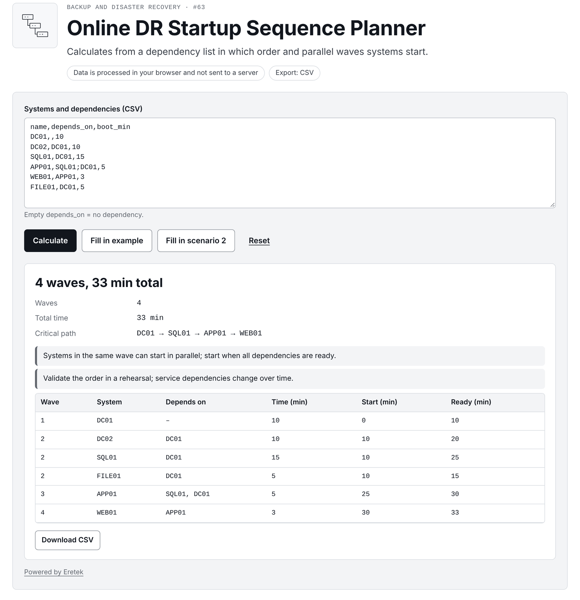

# DR Startup Sequence Planner

Derive DR startup waves, total time and critical path from system dependencies; catches circular and missing dependencies.

## Try it live

- [Türkçe](https://sistem.eretek.com/araclar/felaket-kurtarma-baslatma-sirasi)
- [English](https://sistem.eretek.com/en/tools/dr-startup-sequence)
- [Deutsch](https://sistem.eretek.com/de/werkzeuge/dr-startreihenfolge)



## What it does

Calculates from a dependency list in which order and parallel waves systems start.

Starting all VMs at once during disaster recovery ends with application servers that cannot find their database or authentication. The tool sorts dependencies topologically, shows which systems in the same wave can start in parallel and finds the longest dependency chain (critical path).

## Where it helps

Copy the order into the DR runbook and failover plan steps of your replication software. Update the RTO matrix together with restore times and rehearse at least once a year.

## How to use it

1. CSV header: `name, depends_on, boot_min`. Separate multiple dependencies with `;`.
2. boot_min is the time for the system to start and serve (minutes).
3. Press Calculate; export the order as CSV into the runbook.

### Fields

| Field | Description |
|---|---|
| Systems and dependencies (CSV) | Empty depends_on = no dependency. |

## Example input

Press **Fill in example** in the tool to load this input.

**Systems and dependencies (CSV)**

```text
name,depends_on,boot_min
DC01,,10
DC02,DC01,10
SQL01,DC01,15
APP01,SQL01;DC01,5
WEB01,APP01,3
FILE01,DC01,5
```

**Expected result:** 4 waves: DC01 → DC02, SQL01, FILE01 → APP01 → WEB01; total 33 min; critical path DC01 → SQL01 → APP01 → WEB01.

## Method and assumptions

Topological sort (depth-first). Wave = largest dependency wave + 1. Start = latest ready time of dependencies; ready = start + boot_min. Total time is the latest ready time; the critical path is that chain.

## Limits and common mistakes

- Resource (CPU/storage) limits may restrict parallel starts in a wave; the tool assumes unlimited parallelism.

## Run it locally

The tool is plain HTML, CSS and JavaScript with no build step and no dependencies.

```bash
git clone https://github.com/eretek/dr-startup-sequence.git
cd dr-startup-sequence
node scripts/serve.js        # or: python3 -m http.server 8080
```

Open <http://127.0.0.1:8080/>. Add `?lang=tr` or `?lang=de` for Turkish or German; without it the page follows the browser language and falls back to English. You can also open `index.html` directly from disk.

Run the tests (Node.js 18 or later):

```bash
node test/run.js    # or: npm test
```

The tests run the tool's own fixtures and the worked examples in all three languages without a browser.

## How it works

All processing happens in your browser. The tool makes no network requests, uses no cookies or browser storage, and does not upload files you select.

No server-side component is needed. The version on the Eretek website renders the same page through a private WordPress plugin; that plugin only produces the page markup and is not part of this repository.

| Path | Purpose |
|---|---|
| `index.html` | Page shell |
| `src/app.js` | Builds the page in Turkish, English or German from `src/data.js` |
| `src/data.js` | Field definitions, examples and all texts in three languages |
| `src/core.js` | Shared runtime: validation, number formats, result rendering, CSV/ICS export |
| `src/tool.js` | The calculation or analysis for this tool |
| `docs/screenshot.png` | Screenshot used in this README |
| `src/tools.css`, `src/page.css` | Styles |
| `test/run.js`, `test/cases.json` | Headless tests |

## License and attribution

This tool is released under the [Eretek Website Attribution License](LICENSE). You may use, modify and redistribute it, including commercially. If you make it available on a website or web application, show a visible, clickable credit linking to https://eretek.com/ on every page where the tool is available, for example:

```html
<a href="https://eretek.com/">Powered by Eretek</a>
```

You may add `rel="nofollow"` to the link. Keep the copyright notice and license text in copies and redistributions.
